# **RAM (Memory)**

> **Author:** Miriam Portales

## Table of Contents

- [Introduction](#introduction)
  - [Volatile vs non volatile memory](#volatile-vs-non-volatile-memory)
  - [RAM vs cache vs ROM](#ram-vs-cache-vs-rom)
- [Main Functions](#main-functions)
  - [How RAM works](#how-ram-works)
  - [Pyramid memory](#pyramid-memory)
  - [CPU and RAM](#cpu-and-ram)
  - [Motherboard and RAM](#motherboard-and-ram)
- [Key Specifications](#key-specifications)
  - [DDR4 vs DDR5](#ddr4-vs-ddr5)
  - [DIMM vs SO-DIMM](#dimm-vs-so-dimm)
- [Real-World Examples](#real-world-examples)
  - [RAM Kits DDR4](#ram-kits-ddr4)
  - [RAM Kits DDR5](#ram-kits-ddr5)
- [References](#references)
- [Kahoot Quiz](#kahoot-quiz)

---

## Introduction

RAM (Random Access Memory) is the main memory of a computer. It stores the data and the instructions that the CPU is using at that moment, such as the operating system, the open programs and the files being edited. It is much faster than any storage drive (HDD or SSD), so the CPU can work without waiting for the disk. The more RAM a computer has, the more programs it can run at the same time.

### Volatile vs non volatile memory

- Volatile memory loses the information when the computer turns off. It stores information that the CPU needs quickly while the programs are running. An example of that is RAM or cache memory.

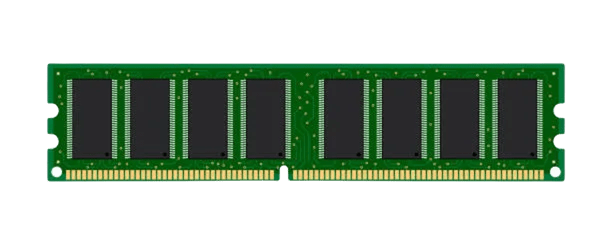

- Non volatile memory doesn't lose the information when the computer turns off. An example is ROM or SSDs.

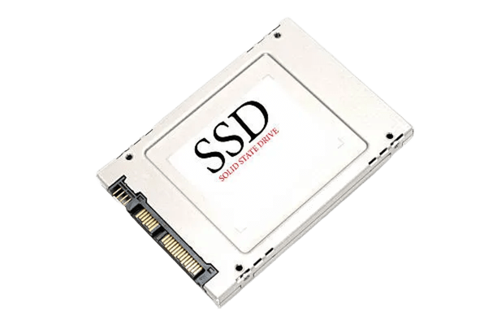

### RAM vs cache vs ROM

The main differences between these memories are the volatility, the speed and the function.

- RAM: It stores the data and instructions for immediate execution. The capacity is important for multitasking.
- Cache: It works like RAM, but it keeps copies of frequently used data from RAM to help the CPU work faster. It is faster than RAM but has less storage space.

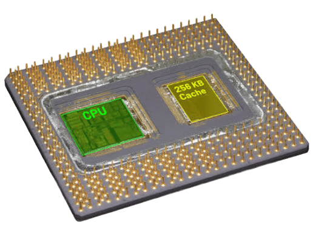

- ROM: It is non volatile memory and the user doesn't change its content easily. It stores the instructions to start the computer and the basic configuration of the hardware.

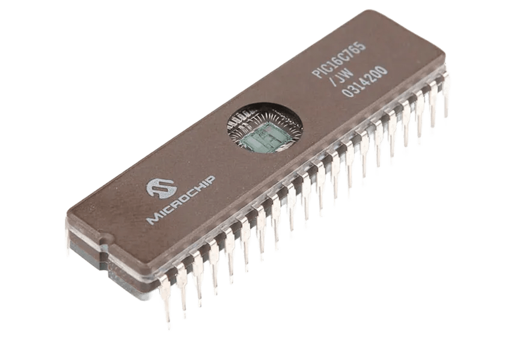

---

## Main Functions

### How RAM works

When you open a program, the operating system copies it from the storage drive (slow, non volatile) into RAM (fast, volatile). The CPU then reads instructions and data from RAM and writes the results back. When you close the program or turn off the computer, the RAM is cleared. If there is not enough RAM, the system has to use part of the drive as virtual memory, and the computer becomes much slower.

### Pyramid memory

The memory is organized in levels. The faster the memory is, the smaller and more expensive it is.

**Level 0 – CPU Registers**
Registers are the fastest and smallest type of memory. They are inside the CPU and hold the data and instructions the CPU is using right now.

**Level 1 – Cache Memory**
Cache is very fast memory located inside or close to the CPU. It stores frequently used data so the CPU can access it quickly.

**Level 2 – Main Memory (RAM)**
RAM stores the data and programs that the computer is using right now. It is faster than disks, but it loses its data when the computer is turned off.

**Level 3 – Magnetic Disk**
Magnetic disks, such as HDDs, store files, programs, and the operating system. They have more capacity than RAM, but they are slower and keep the information even when the computer is turned off.

**Level 4 – Magnetic Tape and Optical Disk**
Magnetic tapes and optical disks, such as CDs and DVDs, are used to store or back up data. They are generally slower to access but can keep data for a long time.

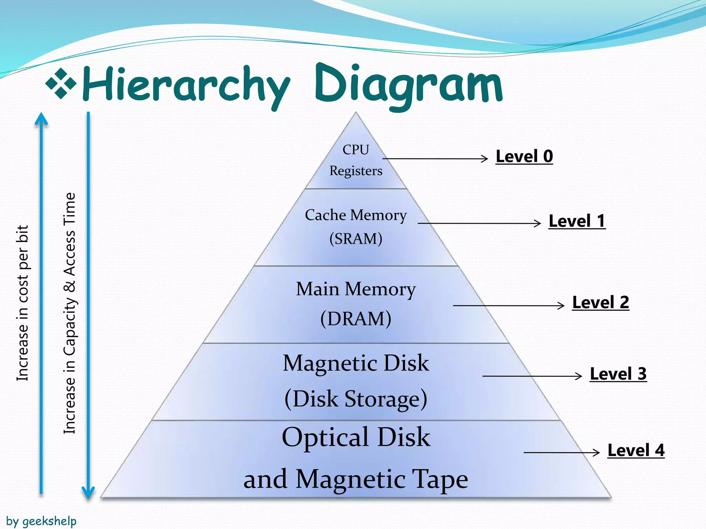

### CPU and RAM

The CPU talks to the RAM through the memory controller, which is inside the processor in modern CPUs. This means that the CPU decides which memory the computer can use:

- Memory type: a CPU can support DDR4, DDR5 or both, depending on the model.
- Speed and channels: each CPU has a maximum memory speed and a number of memory channels that it supports officially. Faster RAM can work at higher speeds only with profiles like XMP or EXPO.
- Cache: the CPU keeps copies of the most used data from RAM in its cache (L1, L2, L3), so it doesn't have to wait for the RAM every time.

### Motherboard and RAM

The RAM modules are installed in the DIMM slots of the motherboard, so both must be compatible:

- DDR generation: a DDR4 module doesn't fit in a DDR5 slot because the notch is in a different position. You must buy RAM of the same generation as the motherboard.
- Number of slots: motherboards usually have 2 or 4 slots, and each one has a maximum total capacity.
- Dual channel: the slots work in pairs. To use dual channel, the modules must be installed in the correct slots (the motherboard manual shows which ones).
- Chipset and BIOS/UEFI: they define the supported speeds, and in the BIOS/UEFI you can activate the XMP or EXPO profile of the RAM.

---

## Key Specifications

### DDR4 vs DDR5

- DDR4: It is an older type of RAM. It is fast and works well for everyday tasks and games. It uses less power than older memory types.
- DDR5: It is a newer type of RAM. It can transfer data faster and offers more memory capacity. It is more energy-efficient than DDR4.

**Capacity:** They both have different capacities like 8 GB, 16 GB, 32 GB, but DDR5 can support higher capacities per module.

**Frequency:** It is measured in MT/s (million transfers per second), but in shops it is usually written as MHz. DDR4 usually works at speeds like 3200 MT/s and DDR5 is faster, with kits at 6400 MT/s or more.

**Latency:** It is how long the RAM takes to respond to a request. A lower CL (CAS Latency) means a faster response when the frequency is the same. DDR4 has a latency between CL16 and CL22 and DDR5 between CL30 and CL40. DDR5 has a higher CL number, but it also has a higher frequency, so the real latency is similar. A lower number of latency doesn't always mean faster RAM. The real latency in nanoseconds is: CL × 2000 / MT/s. For example, DDR4-3200 CL16 is 10 ns and DDR5-6000 CL38 is about 12.7 ns.

**Single vs dual channel:** Single channel uses only one memory channel and dual channel uses two channels to transfer data at the same time. Dual channel gives more bandwidth and more performance. A DDR4 module has one 64-bit channel and a DDR5 module has two 32-bit subchannels. This helps DDR5 to use the data bus better.

**Voltage:** DDR4 works at 1.2 V and DDR5 works at 1.1 V, so DDR5 uses less power.

**Physical differences:** It is easy to tell both of them apart because the notch is in a different position. This stops you from inserting the wrong type of memory and forces you to install it in the correct direction.

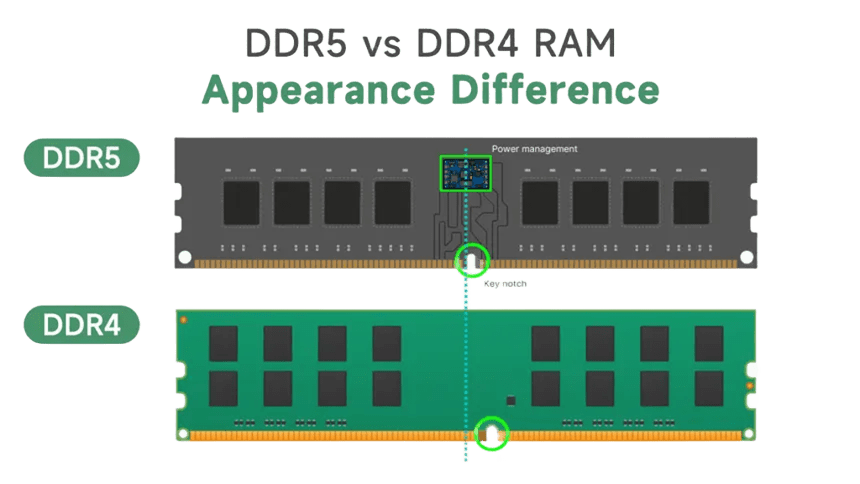

---

### DIMM vs SO-DIMM

DIMM and SO-DIMM are two types of RAM memory. DIMM is bigger and is used in desktop computers because they have more space inside. SO-DIMM is smaller and is used in laptops because they have less space.

They work in the same way, and the difference is their size and the number of pins. Both store data and help the computer run programs. Their performance depends on their speed and other specifications.

| Type | DIMM (desktop) | SO-DIMM (laptop) |
| ---- | -------------- | ---------------- |
| DDR4 | 288 pins       | 260 pins         |
| DDR5 | 288 pins       | 262 pins         |

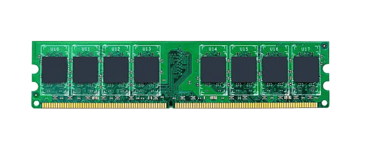
DIMM

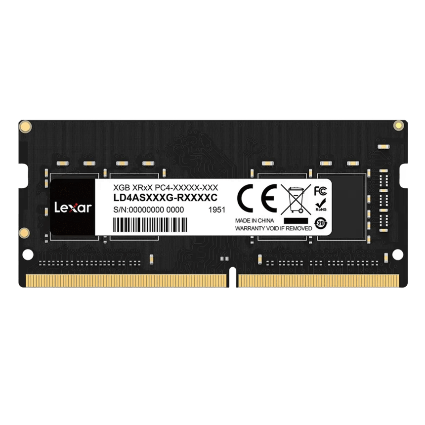
SO-DIMM

---

## Real-World Examples

### RAM Kits DDR4

### Forgeon Cyclone PLUS V2 DDR4 — Forgeon

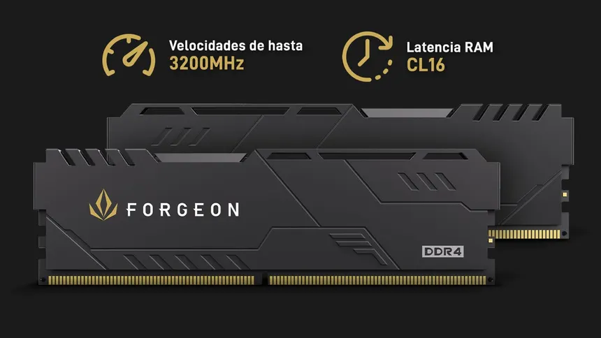

- Key specs: 16 GB (2×8 GB), 3200 MHz, CL16
- Price (checked on 2026-10-28): 149.90 €

[Product page](https://www.pccomponentes.com/memoria-ram-forgeon-cyclone-plus-v2-ddr4-3200-mhz-16gb-2x8gb-cl16-negra)

### G.Skill Ripjaws V DDR4 — G.Skill

- Key specs: 32 GB (2×16 GB), 3600 MHz, CL18
- Price (checked on 2026-10-28): 261.99 €

[Product page](https://www.pccomponentes.com/memoria-ram-g-skill-ripjaws-v-ddr4-3600mhz-pc4-28800-32gb-2x16gb-cl18)

### RAM Kits DDR5

### Kingston FURY Beast DDR5 — Kingston

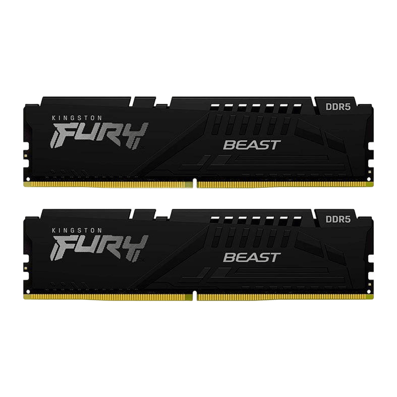

- Key specs: 32 GB (2×16 GB), 5600 MHz, CL36
- Price (checked on 2026-10-28): 629.90 €

[Product page](https://www.pccomponentes.com/kingston-fury-beast-ddr5-5600mhz-32gb-2x16gb-cl36)

### Corsair Vengeance DDR5 — Corsair

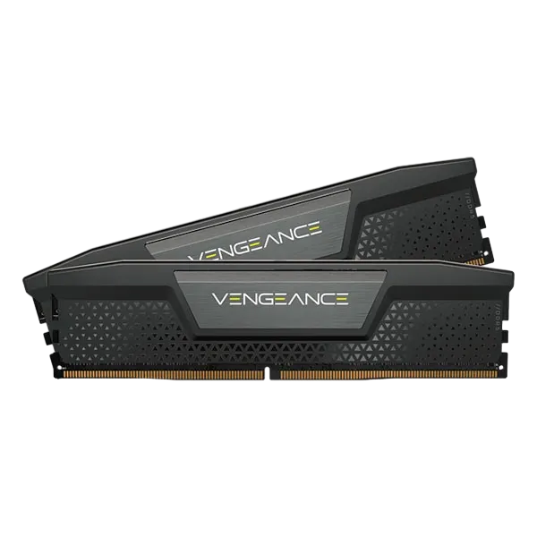

- Key specs: 32 GB (2×16 GB), 6000 MHz, CL38
- Price (checked on 2026-10-28): 542.90 €

[Product page](https://www.pccomponentes.com/memoria-ram-corsair-vengeance-32gb-2x16gb-ddr5-6000mhz-cl38-intel-xmp-negra)

---

## References

- Kingston — What is computer memory — <https://www.kingston.com/es/blog/pc-performance/what-is-computer-memory> — (accessed 2026-10-28)
- Crucial — Difference among DDR2, DDR3, DDR4 and DDR5 memory — <https://test.crucial.com/articles/about-memory/difference-among-ddr2-ddr3-ddr4-and-ddr5-memory> — (accessed 2026-10-28)
- TechTarget — Compare DIMM vs SO-DIMM features and uses — <https://www.techtarget.com/it-infrastructure/tip/Compare-DIMM-vs-SO-DIMM-features-uses> — (accessed 2026-10-28)
- Kingston — Glossary — <https://www.kingston.com/en/memory/kingston-glossary> — (accessed 2026-10-28)
- PcComponentes — Forgeon Cyclone PLUS V2 — <https://www.pccomponentes.com/memoria-ram-forgeon-cyclone-plus-v2-ddr4-3200-mhz-16gb-2x8gb-cl16-negra> — (accessed 2026-10-28)
- PcComponentes — G.Skill Ripjaws V — <https://www.pccomponentes.com/memoria-ram-g-skill-ripjaws-v-ddr4-3600mhz-pc4-28800-32gb-2x16gb-cl18> — (accessed 2026-10-28)
- PcComponentes — Kingston FURY Beast DDR5 — <https://www.pccomponentes.com/kingston-fury-beast-ddr5-5600mhz-32gb-2x16gb-cl36> — (accessed 2026-10-28)
- PcComponentes — Corsair Vengeance DDR5 — <https://www.pccomponentes.com/memoria-ram-corsair-vengeance-32gb-2x16gb-ddr5-6000mhz-cl38-intel-xmp-negra> — (accessed 2026-10-28)

---

## Kahoot Quiz

Play my quiz here: [https://create.kahoot.it/share/ram-test/7a3f937f-a1da-4a97-8288-bdef654acedf](https://create.kahoot.it/share/ram-test/7a3f937f-a1da-4a97-8288-bdef654acedf)
 <https://www.pccomponentes.com/memoria-ram-corsair-vengeance-32gb-2x16gb-ddr5-6000mhz-cl38-intel-xmp-negra>
